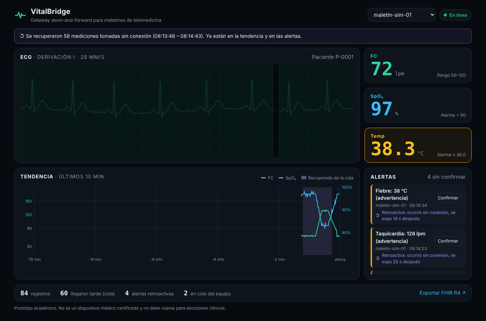
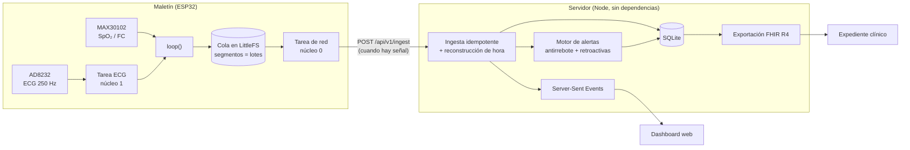

# VitalBridge

**Gateway de bajo costo para maletines de telemedicina que sigue midiendo cuando no hay internet.**
ESP32 + ECG (AD8232) + oximetría (MAX30102), una cola *store-and-forward* en flash y un
dashboard en tiempo real con alertas que no se pierden durante los cortes de red.

[](https://github.com/charrixxz23/vitalbridge/actions/workflows/ci.yml)
· **[Demo en vivo](https://charrixxz23.github.io/vitalbridge/)** (corre entero en el navegador, sin hardware)



---

## El problema

El MINSA de Panamá ha distribuido maletines de telemedicina en 25 instalaciones de 7 regiones,
incluida la Comarca Ngäbe Buglé. Cada maletín trae electrocardiógrafo, oxímetro, tensiómetro,
termómetro y otros equipos digitales ([La Estrella, 2026](https://www.laestrella.com.pa/panama/nacional/asi-funciona-la-telemedicina-en-panama-minsa-reporta-mas-de-160-mil-consultas-atendidas-ED20893575);
[Día a Día](https://diaadia.com.pa/el-pais/realizan-el-lanzamiento-oficial-de-la-primera-fase-del-plan-piloto-de-telemedicina-780614)).

Dos cosas complican su uso donde más se necesitan:

1. **Cada dispositivo es una isla.** Las lecturas no terminan en una sola ficha del paciente.
2. **La conectividad es intermitente.** En giras médicas a zonas de difícil acceso, la propia
   estrategia nacional de salud digital recurre a expedientes *offline*
   ([MINSA, Hoja de ruta 2025–2030](https://www.minsa.gob.pa/sites/default/files/publicacion-general/estrategia_nacional_para_la_transformacion_digital_en_salud.pdf)).
   Un monitor que solo funciona "en vivo" pierde justo los eventos que ocurren sin señal.

## Qué hace

- **Concentra** ECG, FC y SpO₂ en un solo equipo de ~25–50 USD.
- **No pierde datos sin red:** guarda en flash, sobrevive a reinicios y envía en lotes al volver la señal.
- **Fecha bien lo que mide**, aunque el ESP32 no tenga reloj y nunca haya visto internet.
- **Avisa aunque sea tarde:** una desaturación ocurrida sin señal genera la alerta al reconectar,
  marcada como *retroactiva* y con cuánto tiempo después se supo.
- **Habla FHIR R4:** exporta Observations con códigos LOINC para integrarse con un expediente clínico.

## Pruébalo en un minuto

Requiere **Node.js 22.13+**. No hay dependencias que instalar.

```bash
git clone https://github.com/charrixxz23/vitalbridge.git
cd vitalbridge
npm run demo
```

Abre <http://localhost:8080>. El simulador corta la red del segundo 20 al 80 de cada ciclo,
justo cuando el paciente simulado tiene un episodio de desaturación con taquicardia:

1. El dashboard pasa a **Sin señal** y los números se atenúan.
2. El "maletín" sigue midiendo y encolando (lo ves en la terminal).
3. Al volver la señal, la tendencia se rellena con una **franja morada** y aparecen las
   **alertas retroactivas**.

Otras formas de correrlo:

```bash
npm start                                   # solo el servidor (para el ESP32 real)
npm run sim -- --lose-acks 0.2              # pierde 20 % de las respuestas: prueba la idempotencia
npm run sim -- --no-outage --ntp            # sin cortes y con hora absoluta
npm test                                    # 23 pruebas: alertas, ingesta, cola, ECG, FHIR
```

## Arquitectura



| Carpeta | Contenido |
|---|---|
| [`firmware/`](firmware) | ESP32 con PlatformIO: muestreo de ECG en tarea dedicada, oximetría, cola persistente y envío por lotes |
| [`server/`](server) | Ingesta, SQLite, alertas, SSE y FHIR. Solo módulos integrados de Node |
| [`dashboard/`](dashboard) | Monitor tipo cabecera: ECG con barrido a 25 mm/s, signos vitales, tendencia y alertas |
| [`shared/`](shared) | Lógica pura que usan el servidor, el simulador **y** el navegador: cola, ECG sintético, escenario, alertas, FHIR |
| [`simulator/`](simulator) | Maletín simulado con cortes de red y pérdida de respuestas |
| [`docs/`](docs) | [Hardware y conexiones](docs/hardware.md) · [Protocolo de ingesta](docs/protocol.md) |

## Decisiones de ingeniería

**Idempotencia por `(equipo, arranque, secuencia)`.** Si la respuesta HTTP se pierde, el equipo
reenvía el lote y el servidor lo reconoce como duplicado. Reintentar siempre es seguro, que es
lo que permite que el firmware sea simple.

**Hora reconstruida sin RTC.** Cada registro guarda `millis()` y el lote informa el `uptime` al
enviarse. El servidor calcula `ts = llegada − (uptime − t)`. Si hubo NTP, usa la hora absoluta.
Si el dato viene de un arranque anterior sin NTP, no se inventa la hora: se marca como
desconocida, también en el FHIR.

**Cola por segmentos.** Cada archivo en flash es exactamente un lote. Confirmar un envío es
borrar un archivo, sin reescribir la flash. Si se llena, se descarta lo **más viejo** (mejor
perder el minuto 1 de hace una hora que el dato de hace 10 s) y el descarte se reporta: la
pérdida nunca es silenciosa.

**Qué se guarda sin red.** El ECG continuo no cabe en ~1.4 MB. Sin señal, el equipo guarda los
signos vitales cada segundo y una tira de ECG de 10 s cada 30 s. Eso da alrededor de una hora
de autonomía.

**Alertas con antirrebote.** Se requieren dos lecturas seguidas fuera de rango, y se dispara la
severidad *mínima sostenida*: un dedo que se mueve en el oxímetro no es una hipoxemia. Se
evalúan en orden cronológico de medición, no de llegada.

**Dos núcleos, dos tareas.** El ECG se muestrea con `vTaskDelayUntil` en el núcleo 1. La red va
en el núcleo 0, porque un POST lento desbordaría el FIFO del MAX30102 (~1.3 s).

**Una sola lógica, tres lugares.** La cola, el escenario y el motor de alertas del simulador y
de la demo web son los mismos módulos que usa el servidor y que están probados.

## Hardware

ESP32 DevKit + módulo AD8232 + MAX30102, alimentado por batería. Conexiones, lista de
materiales y cómo grabar: **[docs/hardware.md](docs/hardware.md)**.

> ⚠️ Con electrodos puestos, usa **solo batería**. Nunca lo conectes a la vez a una laptop
> enchufada a la red eléctrica.

## Limitaciones y siguiente paso

- Umbrales de alerta orientativos, no validados clínicamente.
- Sin cifrado de transporte en la red local. Para un despliegue real: HTTPS y un token por equipo.
- El cálculo de SpO₂ usa el algoritmo de referencia de Maxim, que es sensible al movimiento.
- Falta integrar tensiómetro y termómetro del maletín (BLE) y un carril prioritario que envíe las
  alertas antes que el resto de la cola al reconectar.

## Aviso

Prototipo académico. **No es un dispositivo médico**, no cumple IEC 60601-1 y no debe usarse
para diagnosticar ni tratar a nadie.

## Autor

**Rafael Batista** · Ingeniería de Sistemas y Computación, Universidad Tecnológica de Panamá.

Licencia [MIT](LICENSE).
